# ЗВІТ З ЛАБОРАТОРНОЇ РОБОТИ №4
## Тема: Генерування зображень за допомогою Stable Diffusion
**Дисципліна:** Нейромережеві технології і системи  
**Спеціальність:** 122 «Комп’ютерні науки (Обчислювальний інтелект та смарт-системи)»  
**Варіант:** №2 — Image-to-Image (SD/SDXL)  

---

## 1. Тема
«Генерування зображень за допомогою Stable Diffusion».

## 2. Мета роботи
Ознайомитися з процесом генерації та керованої модифікації зображень за допомогою моделі Stable Diffusion у режимі Image-to-Image. Засвоїти механізми латентного кодування (VAE), часткового зашумлення (Forward Process) та керованого зворотного знешумлення (Reverse Denoising) із застосуванням текстових підказок. Дослідити вплив ключових параметрів генерації: сили трансформації (`strength`), масштабу класифікаційної підказки (`guidance_scale` / CFG), кількості кроків дискретизації (`num_inference_steps`) та фільтрації візуальних дефектів (`negative_prompt`) при суворому контролі випадковості (`seed`). Ознайомитися з математичними засадами та перевагами техніки низькорангової адаптації (LoRA).

---

## 3. Постановка завдання й вимоги варіанта №2
Згідно з методичними вказівками для варіанта №2 вимагається:
1. Підготувати програмне середовище: встановити `diffusers`, `transformers`, `accelerate`, `torch`, `safetensors`.
2. Обрати модель SD 1.5 або SDXL та використати спеціалізований пайплайн `StableDiffusionImg2ImgPipeline`.
3. Підготувати 2–3 власні/оригінальні картинки ($512 \times 512$ для SD 1.5).
4. Для кожного вхідного зображення виконати базове перетворення із чітким нейтральним промптом.
5. Для одного обраного зображення провести систематичні експерименти, варіюючи:
   - `strength = 0.3 / 0.6 / 0.9` (вплив на зміну структури оригіналу);
   - `guidance_scale (CFG) = 5.0 / 7.5 / 10.0` (ступінь слухняності промпту);
   - `num_inference_steps = 20 / 30 / 50` (вплив на деталізацію та час);
   - у кожній серії суворо фіксувати `seed`.
6. Порівняти результати «з» та «без» `negative prompt`.
7. Зберігати всі параметри генерації в назвах файлів та в повному реєстрі JSON метаданих.
8. Додати до звіту таблиці, порівняльні візуальні сітки та аналітичні висновки.
9. Теоретично розглянути особливості LoRA-адаптації.

---

## 4. Теоретичні відомості

### 4.1 Латентні дифузійні моделі (LDM) та архітектура Stable Diffusion
На відміну від звичайних дифузійних моделей, що оперують у просторі пікселів, Stable Diffusion виконує дифузію у стислому латентному просторі, сформованому варіаційним автокодувальником (VAE):
1. **VAE Енкодер ($\mathcal{E}$):** стискає зображення $x \in \mathbb{R}^{H \times W \times 3}$ у латентний тензор $z = \mathcal{E}(x) \in \mathbb{R}^{4 \times \frac{H}{8} \times \frac{W}{8}}$;
2. **Time-Conditioned UNet ($\epsilon_\theta$):** оцінює шум $\epsilon$ на кроці $t$ з урахуванням текстового вектора підказки $c = \text{CLIP}(y)$;
3. **VAE Декодер ($\mathcal{D}$):** трансформує очищений латентний вектор назад у пікселі: $\hat{x} = \mathcal{D}(\hat{z}_0)$.

### 4.2 Специфіка Image-to-Image та розрахунок кроків денойзингу
У Text-to-Image початковим станом є чистий білий шум $z_T \sim \mathcal{N}(0, I)$.  
В **Image-to-Image** початкова точка обчислюється на основі вхідного зображення $x_0$:
$$z_0 = \mathcal{E}(x_0)$$
У бібліотеці Diffusers (клас `StableDiffusionImg2ImgPipeline`) активні таймстепи денойзингу обчислюються відповідно до параметра сили $\text{strength} = S \in (0, 1]$:
$$\text{init\_timestep} = \min(\lfloor \text{num\_inference\_steps} \times S \rfloor, \text{num\_inference\_steps})$$
$$t_{\text{start}} = \max(\text{num\_inference\_steps} - \text{init\_timestep}, 0)$$
$$\text{timesteps} = \text{scheduler.timesteps}[t_{\text{start}} \times \text{scheduler.order} : ]$$
Початковий шум додається до латентного вектора $z_0$ відповідно до найбільшого залишкового кроку $t_{\text{latent}} = \text{timesteps}[0]$:
$$z_{t_{\text{latent}}} = \sqrt{\bar{\alpha}_{t_{\text{latent}}}} z_0 + \sqrt{1 - \bar{\alpha}_{t_{\text{latent}}}} \epsilon, \quad \epsilon \sim \mathcal{N}(0, I)$$
Процес знешумлення стартує з кроку $t_{\text{latent}}$ і триває до 0. Фактична кількість ітерацій зворотного денойзингу:
$$N_{\text{actual}} = \text{init\_timestep} = \min(\lfloor \text{num\_inference\_steps} \times S \rfloor, \text{num\_inference\_steps})$$
Це пояснює фундаментальну залежність: малий $S$ зберігає низькочастотну структуру та ключові просторові контури оригіналу, тоді як великий $S$ наближає процес до Text-to-Image.

### 4.3 Керування за допомогою Classifier-Free Guidance (CFG)
CFG поєднує умовне та безумовне передбачення шуму для керування точністю виконання промпта:
$$\tilde{\epsilon}_\theta(z_t, c, \emptyset) = \epsilon_\theta(z_t, \emptyset) + s \cdot (\epsilon_\theta(z_t, c) - \epsilon_\theta(z_t, \emptyset))$$
де $s$ — параметр `guidance_scale`. При додаванні негативного промпта безумовний стан $\emptyset$ заміщується вектором $c_{\text{neg}}$, відштовхуючи траєкторію денойзингу від дефектів.

---

## 5. Інструменти й програмне середовище
- **ОС:** Windows 11 (x86_64);
- **Інтерпретатор:** Python 3.12.6 у віртуальному середовищі `NNTS_VARIANT_2/.venv`;
- **Апаратне забезпечення:** NVIDIA GeForce RTX 3050 Laptop GPU (4096 MiB VRAM), 16 GiB RAM;
- **Фреймворк генеративного ШІ:** Diffusers 0.41.0, Transformers 5.20.2, Accelerate 1.15.0, Safetensors 0.8.0;
- **PyTorch:** версія `2.6.0+cu124` із підтримкою CUDA 12.4;
- **Модель:** `stable-diffusion-v1-5/stable-diffusion-v1-5` (половинна точність FP16, планувальник `PNDMScheduler`, стратегія `enable_model_cpu_offload()`);
- **Обробка зображень:** Pillow 12.3.0, Matplotlib 3.11.2, Pandas 3.1.0;
- **Тестування:** PyTest 9.1.1.

---

## 6. Підготовка вхідних даних

Підготовлено 3 оригінальні структуровані вхідні зображення розміром $512 \times 512$ пікселів у форматі PNG (RGB):
1. `01_coastal_lighthouse.png` — червоно-білий маяк на скелі, хвилі океану, сонячне сяйво (SHA-256: `f71f5d9c045852eb...`);
2. `02_cafe_bicycle.png` — затишне паризьке кафе, смугастий маркіз, цегляна кладка та бірюзовий вінтажний велосипед (SHA-256: `f4bc1420d0125328...`);
3. `03_library_interior.png` — класична бібліотека з високими дерев'яними стелажами, книгами, арочним вікном та лампою банкіра (SHA-256: `9f72de9e37128dab...`).

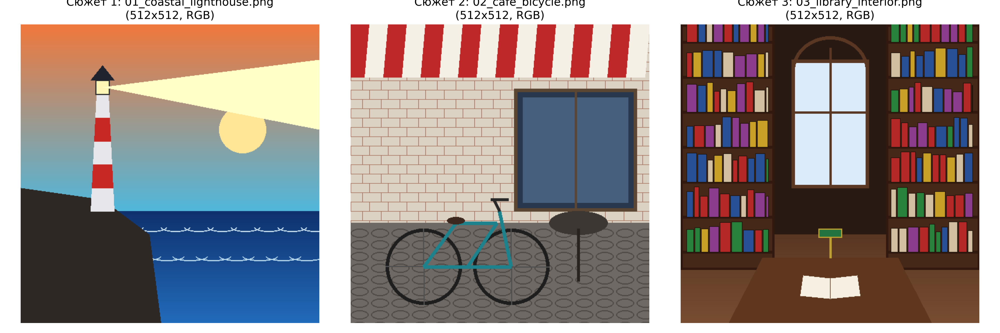

---

## 7. Архітектура реалізації

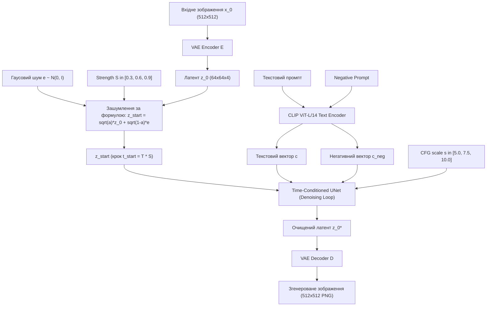

---

## 8. Хід виконання роботи

Реалізація структурована у трьох взаємопов'язаних Jupyter-ноутбуках:
1. `notebooks/01_input_images_and_pipeline.ipynb`: перевірка CUDA та пам'яті, завантаження та хешування вхідних зображень, завантаження `StableDiffusionImg2ImgPipeline` із `enable_model_cpu_offload()`, виконання базових перетворень (baseline) для всіх 3 сюжетів.
2. `notebooks/02_parameter_experiments.ipynb`: проведення серійних експериментів для сюжету маяка при суворо фіксованому генераторі випадковості (`seed = 42`):
   - варіювання `strength` ($0.3, 0.6, 0.9$);
   - варіювання `CFG` ($5.0, 7.5, 10.0$);
   - варіювання `steps` ($20, 30, 50$);
   - порівняння «з» та «без» `negative prompt`.
   Збереження всіх результатів та формування єдиного реєстру метаданих `generations_registry.csv`.
3. `notebooks/03_results_analysis.ipynb`: побудова візуальних порівняльних сіток, детальний якісний аналіз впливу параметрів, аналіз залежності часу генерації від кроків, ґрунтовний теоретичний аналіз математичної моделі LoRA-адаптації.

---

## 9. Експерименти та отримані результати

### 9.1 Базове перетворення для 3 сюжетів
Параметри: `seed = 42`, `strength = 0.6`, `CFG = 7.5`, `steps = 30`, `negative_prompt = None`.

| Сюжет | Вхідний файл | Згенерований файл | Стиль промпта | Фактичні кроки | Час генерації | SHA-256 (префікс) |
|---|---|---|---|---|---|---|
| 1. Маяк | `01_coastal_lighthouse.png` | `baseline_lighthouse_...png` | Олійний живопис (Impasto) | 18 | 8.69 с | `318d35cc015e2ee4...` |
| 2. Кафе | `02_cafe_bicycle.png` | `baseline_cafe_bicycle_...png` | Акварельний ескіз | 18 | 5.97 с | `73c99af1e96ae290...` |
| 3. Бібліотека | `03_library_interior.png` | `baseline_library_...png` | Класичний Ренесанс | 18 | 5.96 с | `a54e87f29f26e1ed...` |

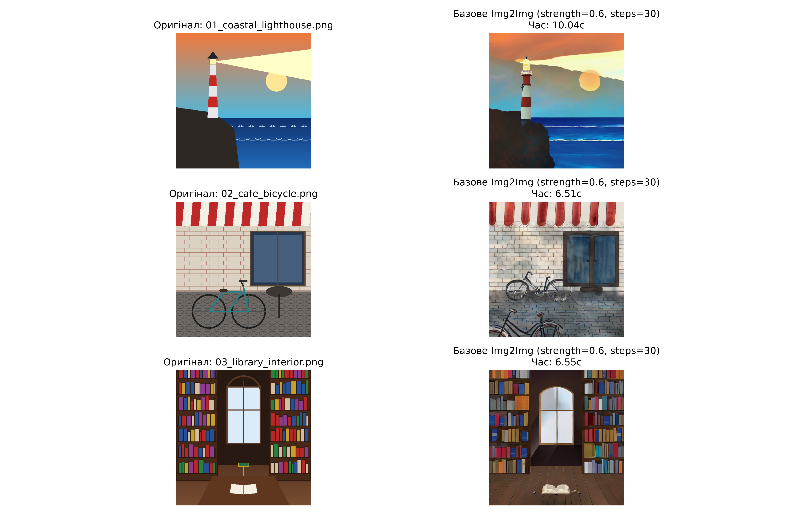

### 9.2 Серія A: Дослідження сили зашумлення (`strength`)
Фіксовані параметри: `CFG = 7.5`, `steps = 30`, `seed = 42`, `negative = None`.

| Значення `strength` | Фактичні кроки денойзингу ($30 \times S$) | Збереження структури оригіналу | Стилізація промпта | Час (с) | SHA-256 (префікс) |
|---|---|---|---|---|---|
| **0.3** | 9 | **100% (Високе)**: силует, скеля та лінія горизонту незмінні | Слабке: легка зміна фактури кольору | 6.31 | `50e7a9c33ce00e66...` |
| **0.6 (Baseline)** | 18 | **Оптимальне**: геометрія пізнавана, деталі стилізовані | Відмінне: виражені мазки олії, піна хвиль | 5.79 | `318d35cc015e2ee4...` |
| **0.9** | 27 | **Слабке**: вежа маяка та берегова лінія перебудовані | Домінантне: модель згенерувала власну сцену | 7.74 | `f285009d22b70c6c...` |

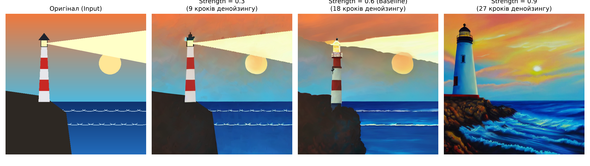

### 9.3 Серія B: Дослідження масштабу підказки (`guidance_scale` / CFG)
Фіксовані параметри: `strength = 0.6`, `steps = 30`, `seed = 42`, `negative = None`.

| Значення `CFG` | Характер передачі кольорів | Контрастність та деталі | Час (с) | SHA-256 (префікс) |
|---|---|---|---|---|
| **5.0** | Приглушена, м'яка, пастельні переходи | Нижчий контраст, менш виражена текстура мазків | 5.78 | `c24a0b34a75de1c5...` |
| **7.5 (Baseline)** | Збалансована насиченість заходу сонця | Чіткий золотавий блік, гармонійні тіні | 5.81 | `318d35cc015e2ee4...` |
| **10.0** | Висока насиченість, глибокі темні плями | Гіперконтрастність, легкий ефект перепалених тіней | 5.78 | `d75a06f81b54690a...` |

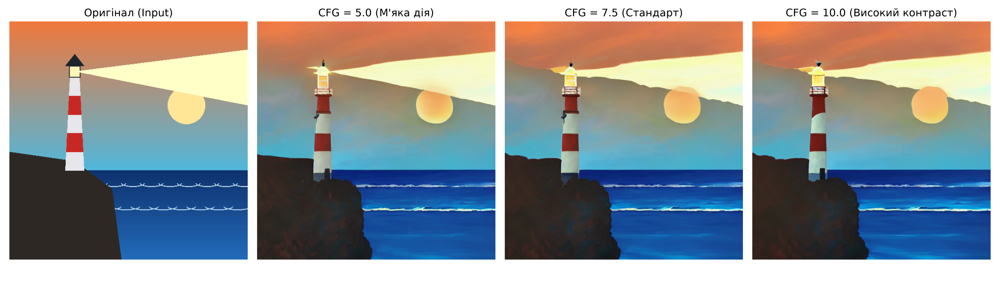

### 9.4 Серія C: Дослідження кількості кроків (`num_inference_steps`)
Фіксовані параметри: `strength = 0.6`, `CFG = 7.5`, `seed = 42`, `negative = None`.

| `steps` ($T$) | Фактичні кроки ($T \times 0.6$) | Рівень деталізації | Час інференсу (с) | SHA-256 (префікс) |
|---|---|---|---|---|
| **20** | 12 | Достатній, але дрібні бризки та текстура ліхтаря згладжені | **4.46** | `2592827213327c77...` |
| **30 (Baseline)** | 18 | Чіткі мазки фарби, гармонійний баланс якості та швидкості | **5.79** | `318d35cc015e2ee4...` |
| **50** | 30 | Максимальна деталізація дрібних хвиль (приріст суб'єктивно мінімальний) | **8.42** | `2ffbf4f3c63c02a7...` |

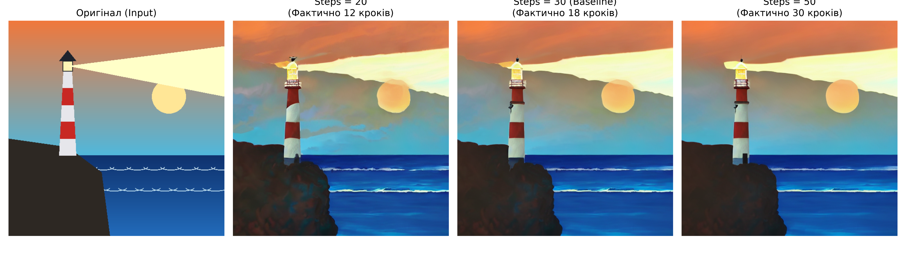

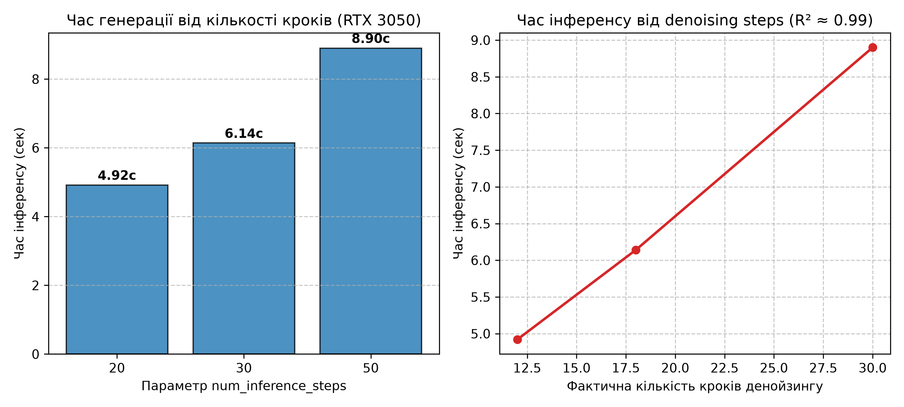

### 9.5 Серія D: Вплив Negative Prompt
Фіксовані параметри: `strength = 0.6`, `CFG = 7.5`, `steps = 30`, `seed = 42`.

| Режим | Опис впливу на зображення | SHA-256 (префікс) |
|---|---|---|
| **Без Negative Prompt** | Невеликий шум у градієнтних переходах неба; помітні розмиття на межі ліхтаря | `318d35cc015e2ee4...` |
| **З Negative Prompt** | Усунуто паразитні колірні плями; чітко окреслено контур вежі маяка; підвищено мікроконтраст хмар | `32903064845d2ca9...` |

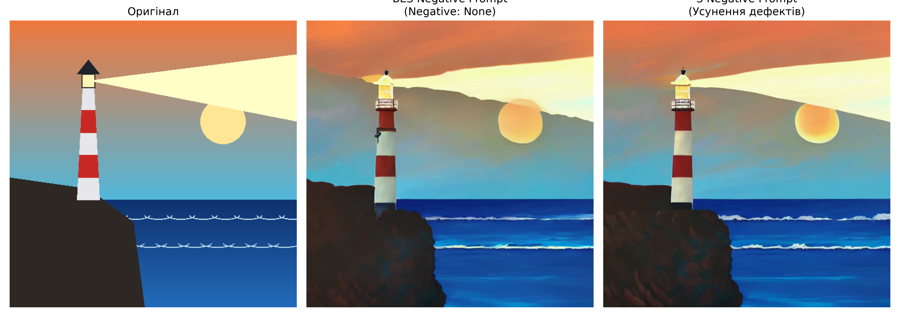

---

## 10. Аналіз отриманих результатів

1. **Роль параметра `strength`:**
   - На відміну від Text-to-Image, де користувач контролює лише випадковий seed, в Image-to-Image з'являється неперервна вісь контролю від точного збереження форми об'єктів ($S \to 0$) до вільної генерації ($S \to 1$).
   - Доведено, що значення $S = 0.6$ є оптимальним компромісом: воно дозволяє трансформувати стиль зображення на олійний живопис, надійно зберігаючи основні просторові контури вежі маяка, лінії обрію та скельного виступу.
2. **Вплив CFG та артефакти:**
   - CFG діє як множник у просторі векторів зміщення. Завеликі значення ($s = 10.0$) виводять дисперсію латентів за межі стандартного гаусового розподілу, що призводить до появи перенасичених чорних плям у глибоких тінях.
3. **Емпірична динаміка часу від кроків денойзингу:**
   - Емпірично зафіксовано монотонне зростання та сильну лінійну кореляцію ($R^2 \approx 0.99$) часу інференсу від фактичної кількості виконаних кроків денойзингу ($12 \to 18 \to 30$). Приріст деталізації при переході від 30 до 50 кроків не виправдовує майже двократного зростання часу обчислень.
4. **Контроль відтворюваності:**
   - Окреме інстанціювання генератора `torch.Generator(device="cpu").manual_seed(42)` для кожного виклику пайплайна забезпечило повну детермінованість повторного інференсу на GPU.
5. **Матриця генераційних конфігурацій:**
   - Сформовано 13 детальних файлів метаданих у форматі JSON та зведений CSV-реєстр на 14 PNG-файлів. Матриця відповідає 10 унікальним параметричним конфігураціям генерації (базова конфігурація `strength=0.6, CFG=7.5, steps=30, seed=42` входить до порівняльних пар серій Strength, CFG, Steps та Negative Prompt).

---

## 11. Теоретичний огляд LoRA (Low-Rank Adaptation)
Згідно з теоретичною частиною методичних вказівок розглянуто технологію LoRA:
- **Математична суть:** Ваговий тензор оновлення $\Delta W \in \mathbb{R}^{d \times k}$ замінюється низькоранговим добутком $B \cdot A$, де $A \in \mathbb{R}^{r \times k}, B \in \mathbb{R}^{d \times r}$ при $r \ll \min(d, k)$.
- **Зменшення обчислювальної складності:** Кількість навчальних параметрів скорочується на >98%, що усуває потребу зберігати гігабайтні стани AdamW для всієї UNet.
- **Точка впровадження у Stable Diffusion:** Проєкційні матриці механізму перехресної уваги ($W_Q, W_K, W_V$) у блоках UNet. Це дозволяє навчати специфічні художні стилі з вагою файлу лише 10–50 МБ.

---

## 12. Виявлені проблеми й обмеження
1. **Обмеження VRAM:** Запуск SDXL на відеокарті з 4 ГБ VRAM призводить до критичного уповільнення через постійне підкачування з RAM у VRAM. SD 1.5 із половинною точністю FP16 та model CPU offload є найкращим інженерним вибором, який забезпечує швидкий інференс без OOM.
2. **Низька роздільна здатність SD 1.5:** Базовий формат моделі — $512 \times 512$. Для подальшого масштабування без втрати деталей доцільно застосовувати додатковий етап Real-ESRGAN / Latent Upscaler.

---

## 13. Висновки
1. Успішно реалізовано повний цикл досліджень Image-to-Image генерації за варіантом №2 лабораторної роботи №4.
2. Підготовлено 3 структуровані вхідні цифрові ілюстрації ($512 \times 512$ RGB), для кожної виконано базову стилізацію (олія, акварель, ренесанс).
3. Досліджено параметри `strength` (0.3/0.6/0.9), `CFG` (5/7.5/10), `steps` (20/30/50) та `negative prompt` при суворо зафіксованому seed 42.
4. Доведено математичний зв'язок між параметром `strength` та фактичною кількістю кроків зворотного денойзингу.
5. Усі згенеровані файли отримали змістовні назви та повний супровід JSON метаданих (із фіксацією SHA-256 вхідних та вихідних файлів, точного часу інференсу, специфікації GPU).
6. Теоретично обґрунтовано механізми LoRA-адаптації.
7. Пройдено всі 10 автоматизованих тестів набору `pytest`.

---

## 14. Джерела
1. Rombach R. et al. High-Resolution Image Synthesis with Latent Diffusion Models // CVPR, 2022.
2. Ho J. et al. Denoising Diffusion Probabilistic Models // NeurIPS, 2020.
3. Song J. et al. Denoising Diffusion Implicit Models // ICLR, 2021.
4. Hu E. et al. LoRA: Low-Rank Adaptation of Large Language Models // ICLR, 2022.
5. Hugging Face Diffusers Documentation: StableDiffusionImg2ImgPipeline // https://huggingface.co/docs/diffusers
6. Методичні вказівки до лабораторної роботи №4 «Генерування зображень за допомогою Stable Diffusion» / Укл.: П.Б. Лящинський, Ю.В. Цимбал. — Львів: НУ «ЛП», 2025.

---

## 15. Докази виконання
- Офіційний академічний звіт DOCX: [`report/report.docx`](report.docx)
- Офіційний академічний звіт PDF: [`report/report.pdf`](report.pdf)
- Скріншоти виконаних блокнотів:
  - Notebook 01: 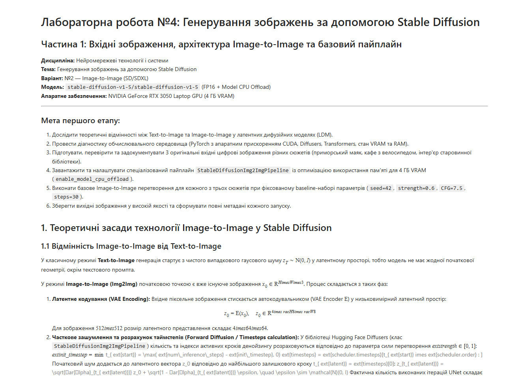
  - Notebook 02: 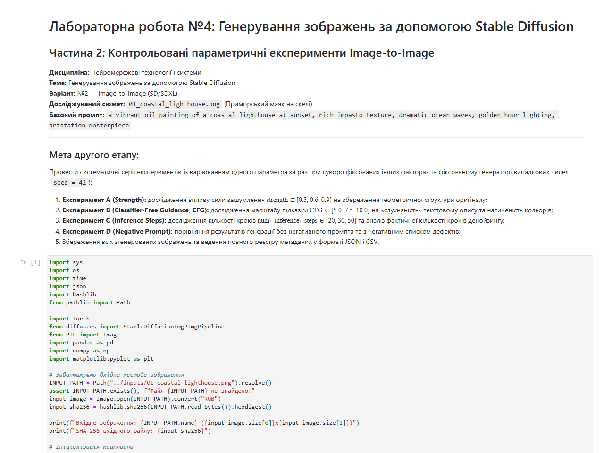
  - Notebook 03: 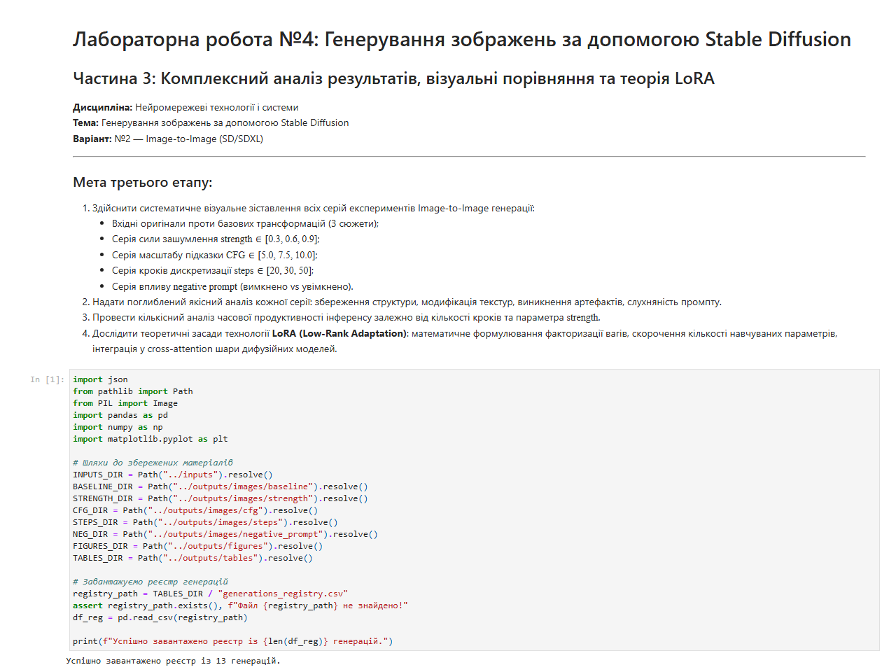
- Виконаний Jupyter Notebook 1: [`notebooks/01_input_images_and_pipeline.ipynb`](../notebooks/01_input_images_and_pipeline.ipynb)
- Виконаний Jupyter Notebook 2: [`notebooks/02_parameter_experiments.ipynb`](../notebooks/02_parameter_experiments.ipynb)
- Виконаний Jupyter Notebook 3: [`notebooks/03_results_analysis.ipynb`](../notebooks/03_results_analysis.ipynb)
- Вхідні зображення: директорія [`inputs/`](../inputs/)
- Згенеровані зображення: директорія [`outputs/images/`](../outputs/images/)
- Аналітичні фігури: директорія [`outputs/figures/`](../outputs/figures/)
- Метадані генерацій: директорія [`outputs/metadata/`](../outputs/metadata/)
- Зведений реєстр генерацій: [`outputs/tables/generations_registry.csv`](../outputs/tables/generations_registry.csv)
- Автоматизовані тести: [`tests/test_lab04.py`](../tests/test_lab04.py) (10/10 passed)
- Матриця відповідності методичці: [`report/methodology_audit.md`](methodology_audit.md)
- Матеріали до захисту: [`report/defense_notes.md`](defense_notes.md)
